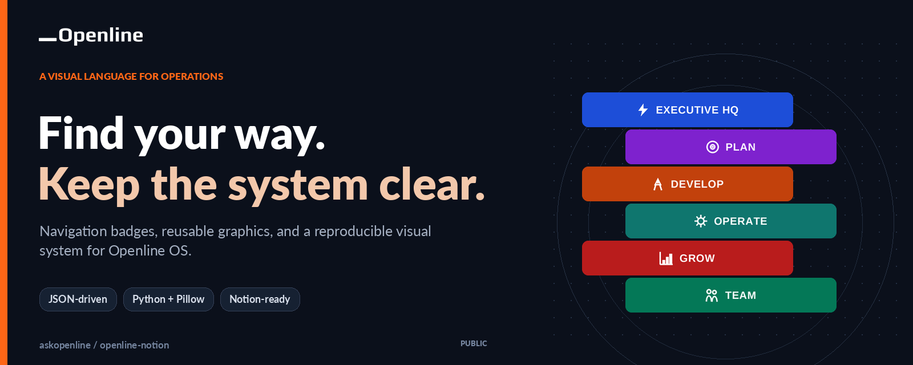
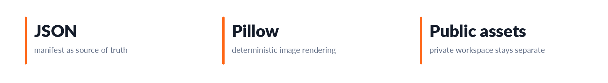
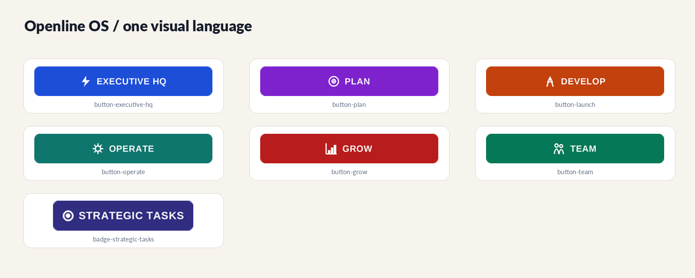
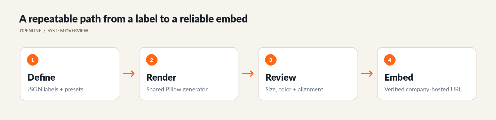

# Openline OS Visual System

<!-- CUP-OF-NEWS-STYLE -->
<div align="center">

[](https://openline.com)
[](https://github.com/askopenline/openline-notion)
[](https://github.com/askopenline/openline-notion/releases)
[](#build-the-assets)




**Navigation badges, reusable graphics, and a reproducible visual system for Openline OS.**

[Company website](https://openline.com) · [Project overview](https://openline.com) · [Release history](https://github.com/askopenline/openline-notion/releases) · [Contribution guide](.github/OPENLINE-CONTRIBUTING.md)

</div>

---

A consistent visual language for Openline's company operating system in Notion. Navigation badges, section graphics, cover artwork, and supporting images are maintained alongside the manifest and renderer that make the system reproducible.

<p align="center">
  <a href="#visual-library"><strong>Explore the visual library</strong></a> ·
  <a href="badge-system/badges.json">Asset manifest</a> ·
  <a href="#build-the-assets">Build the assets</a> ·
  <a href="#embed-and-update">Embedding guide</a> ·
  <a href="https://github.com/askopenline/openline-notion/releases">Releases</a>
</p>



---

## Visual library

The system uses repeatable shapes, clear labels, and controlled color variation to make a large workspace easier to navigate. The main navigation is designed as a family, not as unrelated images redrawn each time a page is added.



| Family | Use |
| --- | --- |
| Main navigation | Consistent entry points for Executive, Plan, Develop, Operate, Grow, and Team areas |
| Section badges | Clear labels for recurring groups and workflows |
| Staff-area graphics | Supporting visuals for people and team operations |
| Covers | Workspace and section-level visual context |
| Supporting captures | Approved images used by operating and review documentation |

This public repository is an image library, not an export of private Notion databases or workspace permissions. Review the content of a new capture before treating it as a public asset.

---

## One manifest, one renderer



The manifest defines what should exist, while the renderer controls how related assets look. That division keeps labels, slugs, dimensions, colors, and icon treatment consistent across revisions.

| File | Responsibility |
| --- | --- |
| [`badge-system/badges.json`](badge-system/badges.json) | Declarative badge and supporting-asset definitions |
| [`badge-system/gen_badge.py`](badge-system/gen_badge.py) | Shared rendering behavior, colors, icons, and presets |
| [`badge-system/build_all.py`](badge-system/build_all.py) | Batch generation |
| [`badge-system/README.md`](badge-system/README.md) | Generator instructions |
| [`os-nav/`](os-nav/) | Generated navigation and section images |
| [`staff/`](staff/) | Staff-area resources |
| [`covers/`](covers/) | Cover artwork |
| [`shots/`](shots/), [`out_images/`](out_images/) | Supporting captures and prepared images |

The retained [`BADGE-SYSTEM.md`](BADGE-SYSTEM.md) and [`CONTEXT.md`](CONTEXT.md) provide earlier design and maintenance context. Treat those records as background where the current company README or generator defines a newer operating convention.

---

## Build the assets

Use Python 3, Pillow, and the font configured by the renderer. The existing manifest is the safest starting point for a new asset because it shows the supported fields and presets.

```sh
git clone https://github.com/askopenline/openline-notion.git
cd openline-notion
python3 -m venv .venv
. .venv/bin/activate
pip install Pillow

python3 badge-system/build_all.py --dir os-nav
```

The command writes generated images. Review the resulting diff and a visual contact sheet before committing, especially when changing a shared preset that affects many siblings.

### Design acceptance

- **Labels:** Preserve spelling, capitalization, meaning, and intentional abbreviations.
- **Geometry:** Keep sibling dimensions consistent where the navigation requires equal-sized buttons.
- **Alignment:** Center text and icons deliberately rather than stretching an existing bitmap.
- **Contrast:** Check labels against their background at the actual embed size.
- **Alpha:** Verify transparency and edge treatment against both light and dark surrounding surfaces.
- **Stability:** Preserve referenced slugs unless the consuming Notion blocks will also be updated.

---

## Embed and update

New embeds should use the official company repository. A navigation badge can use this current-branch pattern:

```text
https://raw.githubusercontent.com/askopenline/openline-notion/main/os-nav/badge-strategic-tasks.png
```

For a deliberate workspace update, prefer a URL pinned to the reviewed full commit SHA. Verify the served image before updating Notion, then replace the affected image reference rather than assuming an overwritten filename refreshes every consumer.

### Understand the cache boundary

GitHub delivery and Notion's image proxy are separate cache layers. A fresh query token can create a new Notion proxy reference, but it should not be treated as proof that the upstream file has already refreshed.

1. Commit the approved image and identify its exact revision.
2. Check that the company URL returns the intended bytes and dimensions.
3. Use the immutable revision URL for the Notion update.
4. Re-fetch the page and inspect the resulting visual.
5. Keep the old working revision available for rollback.

---

## Public library and private archive

The company maintains a separate private audit archive for internal evidence and historical assets. Public Notion imagery should come from this reviewed public library; do not change a private repository's visibility or expose a sensitive capture merely to repair an embed.

Copying a repository does not itself edit Notion blocks or synchronize two asset collections. Use an explicit, verified update for every affected consumer.

---

## Design and technology choices

### A manifest, not manual repetition

Definitions describe labels and presets, while one renderer keeps sibling graphics aligned. A shared style change can be reproduced instead of redrawn asset by asset.

### Stable visual navigation

Consistent dimensions and referenced slugs make the library easier to use inside a large workspace. A filename change is therefore a consumer migration, not just tidying.

### Public assets, separate workspace

The graphics can be public without exporting Notion databases or permissions. Each new image still needs disclosure review before public hosting.

---

## Maintenance and ownership

The [company changelog](OPENLINE-CHANGELOG.md), [releases](https://github.com/askopenline/openline-notion/releases), and [contribution guide](.github/OPENLINE-CONTRIBUTING.md) describe maintained snapshots and review expectations. Sensitive content concerns should follow the [security guide](.github/OPENLINE-SECURITY.md).

Openline maintains the company-created graphics and generator documentation in this library. Fonts, third-party icons, screenshots of other products, and other incorporated resources retain their respective rights and notices.
